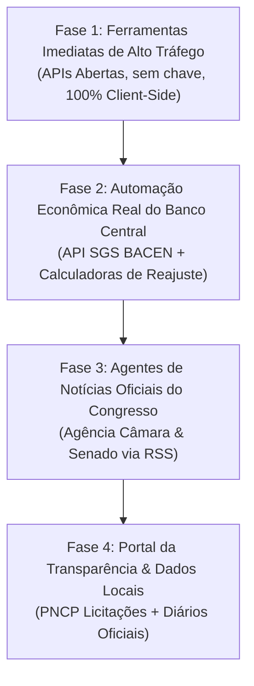

# 🗺️ Plano Estratégico de Expansão: Cidadão Agora

Este plano compara as novas ideias com o estado atual do portal e organiza as implementações em **fases lógicas e de alto impacto**, priorizando ferramentas com **APIs públicas abertas e gratuitas**, alto volume de busca no Google e alto RPM de AdSense.

---

## 📊 1. Raio-X: O que já temos vs. O que podemos adicionar

| Categoria | Já Implementado no Portal ✅ | Novas Oportunidades Selecionadas 🚀 |
| :--- | :--- | :--- |
| **Veículos & Trânsito** | Consulta Placa, FIPE oficial, IPVA por UF, Logos das montadoras, Cache e Rate Limit | Histórico completo / Laudo pago (Leilão e Sinistro via PIX) |
| **Notícias & Política** | Agente EBC Geral, Agente Política 24h com GitHub Actions | Notícias Agência Câmara & Senado (RSS), Pauta da semana |
| **Finanças & Economia** | Hub Atualidades, Termômetro econômico, Guias FIPE/Poupança | API SGS Banco Central (Dólar/Selic/IPCA/IGP-M automáticos), Reajuste de Aluguel |
| **Documentos & Cidadão** | Recibos, Contratos, Declarações, Validador CPF, Buscador CNAE, Rescisão CLT | Busca de CEP (ViaCEP), Feriados Nacionais (BrasilAPI), Gerador de Pedido LAI |
| **Transparência & Cidades** | N/A (Foco inicial foi serviços e notícias) | Licitações PNCP, Diários Oficiais (Querido Diário), Comparador de Cidades (IBGE) |

---

## 🚀 2. Fases de Implementação Recomendadas

---

### 🟢 FASE 1: Ferramentas Rápidas e Imediatas (Zero Custo / Alto Volume de Busca)
*Foco: Ferramentas que as pessoas buscam no Google todos os dias e usam direto no navegador, sem precisar de chaves privadas de API.*

1. **Consulta de CEP & Endereço Completo:**
   - **Fonte:** `ViaCEP` / `BrasilAPI` (100% grátis e pública).
   - **Utilidade:** O usuário digita o CEP e o sistema preenche rua, bairro, cidade, UF e DDD com mapa integrado.
2. **Calculadora de Reajuste de Aluguel (IGP-M & IPCA):**
   - **Fonte:** Fórmula padrão sobre os índices oficiais.
   - **Utilidade:** Altíssima procura no Google todo início de mês por locatários e proprietários.
3. **Calendário Dinâmico de Feriados Nacionais e Pontos Facultativos:**
   - **Fonte:** `BrasilAPI (/api/feriados/v1/{ano})`.
   - **Utilidade:** Visualização limpa dos feriados do ano vigente, emendas de feriados e dias úteis.
4. **Gerador de Pedido LAI (Lei de Acesso à Informação):**
   - **Fonte:** Client-side puro (sem API externa).
   - **Utilidade:** Formulário guiado com modelos formais para o cidadão copiar e protocolar pedidos no Fala.BR.

---

### 🟡 FASE 2: Dados Econômicos Automáticos do Banco Central (BACEN)
*Foco: Tornar os indicadores da página de Atualidades 100% automatizados com histórico e gráficos.*

1. **Painel Dinâmico API SGS do Banco Central:**
   - **Fonte:** API de Séries Temporais do Banco Central (SGS) - Aberta e gratuita.
     - Série `432`: Meta Selic
     - Série `433`: IPCA mensal
     - Série `189`: IGP-M mensal
     - Série `1`: Dólar Comercial PTAX (venda)
   - **O que faz:** Atualiza os cartões de Dólar, Selic e Inflação na página de Atualidades diretamente da fonte oficial do Governo, sem intervenção manual.
2. **Calculadora do Cidadão Independente:**
   - Correção de valores pela inflação (IPCA) e simulador de rendimento Poupança vs CDI.

---

### 🔵 FASE 3: Expansão do Agente de Notícias do Congresso (Poder Legislativo)
*Foco: Fortalecer o jornalismo oficial e a credibilidade do portal no Google Notícias e AdSense.*

1. **Agência Câmara e Agência Senado integradas ao Robô:**
   - **Fonte:** RSS Oficial da Agência Câmara e Agência Senado (Creative Commons).
   - **O que faz:** O mesmo robô Python que já roda a cada 1 hora no GitHub Actions passa a ler também as pautas do Senado e da Câmara, gerando resumos com fotos oficiais e links de tramitação.
2. **Pauta da Semana no Congresso:**
   - Página que lista os projetos prioritários que vão a votação na semana (ex: Reforma Tributária, Escala 6x1, Orçamento).

---

### 🟣 FASE 4: Fiscalização, Transparência & Dados Regionais
*Foco: Ferramentas de utilidade cívica com diferencial geográfico.*

1. **Monitor de Contratações Públicas (PNCP):**
   - **Fonte:** API oficial de dados abertos do `Portal Nacional de Contratações Públicas (PNCP)`.
   - **O que faz:** Busca contratos e licitações recentes abertas no município selecionado (ex: obras, merenda, saúde).
2. **Comparador Municipal (IBGE SIDRA):**
   - Comparação lado a lado entre duas cidades (população, PIB per capita, frota de veículos, IDHM).

---

## ⚖️ Conformidade Legal & Segurança Mantida
- **Sem violação de direitos autorais:** Uso estrito de fontes estatais de domínio público e Creative Commons (Agência Brasil, Câmara, Senado, IBGE, BACEN).
- **Sem sobrecarga de servidores:** Requisições via APIs REST oficiais e caches locais (Cloudflare / localStorage).
- **LGPD:** Apenas dados abertos agregados e de agentes públicos, sem exposição de CPF de cidadãos comuns.
